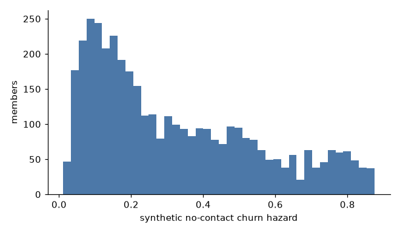
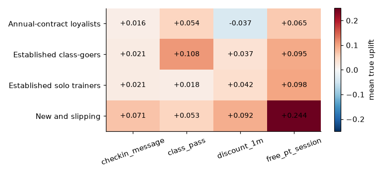
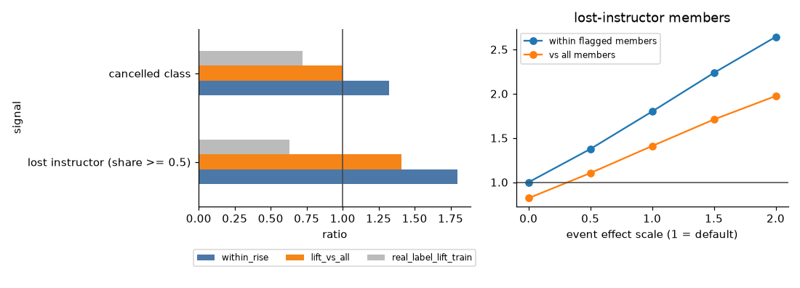

# Appendix: scenario layer parameters

*Code in `SystemCode/backend/anchorai/scenario/build.py` (generation) and `scenario/tables.py` (column contract); sanity checks in `SystemCode/notebooks/a_scenario_uplift.ipynb`. Everything here is regenerated by `uv run anchorai data build` and is deterministic in `ANCHORAI_SEED` (42 for every reported result). The developer copy of this appendix is `docs/SCENARIO.md`.*

## Purpose

The Kaggle snapshot has no clubs, classes, instructors, offers or contact history. The knowledge graph, the case-based reasoner, the uplift models and the optimiser all need them. The scenario layer attaches a small synthetic gym to the 4,000 real members, with a documented ground truth. Experiments that use it (the uplift baseline and E3–E7) test whether the system recovers known structure and decides well against a known truth. They are not claims about how real members respond.

| Table | Real (Kaggle) | Synthetic |
|---|---|---|
| `members` | all 14 Kaggle columns, renamed to lower case | `member_id`, `club_id`, `monthly_value`, `split` |
| `instructors`, `classes`, `attendance`, `offers` | none | all |
| `interventions`, `events` | none | all |
| `true_uplift`, `true_churn` | none | all (scenario-only ground truth) |

## Parameters

| Parameter | Value | Name in `build.py` |
|---|---|---|
| Scoring date | 12 Oct 2026 | `AS_OF` |
| Clubs | C1, C2, C3; each member assigned uniformly at random | `CLUBS` |
| Instructors | 3 per club, 9 in total | `INSTRUCTORS_PER_CLUB` |
| Classes | 2 per instructor, 18 in total | `CLASSES_PER_INSTRUCTOR` |
| Classes per group-class member | 1 to 3, uniformly, at the member's own club | `build_attendance` |
| Monthly fee by contract length | $72 (1 month), $54 (6 months), $46 (12 months) | `MONTHLY_PRICE` |
| History window | 12 weeks before the scoring date | `HISTORY_WEEKS` |
| Members with a past contact | 60%, i.e. 2,400 members | `HISTORY_SHARE` |
| Share of those given an offer | 60% in expectation; 1,416 drawn | `TREATED_SHARE` |
| Event effects (log-odds per full share of visits) | instructor left 1.4; class cancelled 0.9 | `EVENT_EFFECTS` |
| Seed | 42 | `ANCHORAI_SEED` |

**Names.** The instructors are Sam Rivera, Priya Nair and Lee Wong (C1); Maya Chen, Omar Haddad and Ana Costa (C2); Tom Becker, Nora Ali and Ken Sato (C3). The 18 classes are Spin, HIIT, Yoga, Pilates, Boxfit, Circuit, Zumba, Core, Stretch, Bootcamp, Barre, Step, Kettlebell, Aqua, Mobility, TRX, Dance and Power, two per instructor in that order.

## Gym structure

**Attendance.** Members with `group_visits = 1` attend 1 to 3 classes at their own club. Their weekly visits are split across those classes with random weights, so the total equals their real Kaggle `avg_class_frequency_total`. Members whose frequency is zero, or whose share rounds to zero, get no attendance row. 1,611 members have at least one class.

**Offers.** Four retention offers. The same catalogue seeds the app's offer table. The eligibility notes are enforced by the rule base's guardrails, not by the scenario.

| `offer_id` | Cost | Staff minutes | Weekly stock | Channels | Skill | Eligibility |
|---|---|---|---|---|---|---|
| `checkin_message` | $0 | 5 | unlimited | SMS, email, call | — | any active member |
| `free_pt_session` | $40 | 60 | 40 | call, in person | trainer | no PT in the last 90 days |
| `class_pass` | $15 | 10 | 100 | SMS, email, call | — | any active member |
| `discount_1m` | $12 | 15 | unlimited | email, call | — | month-to-month members only |

## Ground truth: churn without contact

Each member's churn hazard for the next month, with no contact, uses features only, never the real churn label:

```
z = −1.4 + 1.3·[lifetime ≤ 2] + 1.1·[trend_ratio < 0.7] − 0.9·[contract = 12]
         − 0.4·group_visits − 0.5·(visits_per_week_total − 1.9)
base_churn  = sigmoid(z)
event_churn = sigmoid(z + event shift)      equal to base_churn for members no event touches
```

The hazard spreads from about 0.01 to 0.87 (`a5_base_hazard.png`). It correlates 0.715 with the real churn label, so the scenario's risk is consistent with the real data without being fitted to it (`a_scenario_uplift.ipynb`, cell 4).



## Ground truth: offer effects (`true_uplift`)

The raw effect of each offer on next-month retention, where `falling = trend_ratio < 0.85`, `new = lifetime ≤ 3` and `price_sensitive = contract = 1 and extra spend < 120`:

| Offer | Raw effect |
|---|---|
| `checkin_message` | 0.02 + 0.04·falling |
| `free_pt_session` | 0.02 + 0.14·new + 0.04·falling |
| `class_pass` | 0.01 + 0.10·group_visits + 0.04·promo_friends |
| `discount_1m` | 0.01 + 0.12·price_sensitive − 0.06·[contract = 12] |

- **Scaling by risk.** Each raw effect is multiplied by (0.6 + hazard), so persuasion matters more for members who are at risk.
- **Realised uplift.** `uplift = clip(1 − hazard + scaled effect, 0, 1) − (1 − hazard)`. The effect saturates when retention is already near certain.
- **Which hazard.** `true_uplift` describes contacting a member now, after the gym events, so it uses `event_churn`.
- **Negative effects.** The only negative raw effect is the discount for annual-contract members (0.01 − 0.06): a discount can lower their retention, the "sleeping dogs" case.

**Heterogeneity** (mean true uplift by segment, in probability points; `results/a5_true_uplift_by_segment.csv`):

| Segment | Check-in | Class pass | Discount | Free PT |
|---|---|---|---|---|
| New and slipping | +7.1 | +5.3 | +9.2 | +24.4 |
| Established solo trainers | +2.1 | +1.8 | +4.2 | +9.8 |
| Established class-goers | +2.1 | +10.8 | +3.7 | +9.5 |
| Annual-contract loyalists | +1.6 | +5.4 | −3.7 | +6.5 |



Over all 16,000 member and offer pairs, the mean true uplift is +5.8 points (`results/a6_tlearner_recovery.csv`).

## Gym events (`events`, `true_churn`)

**What happens.** In the week of 5 October 2026, the week before the scoring date:

| Event | Type | Entity | Rule that picks it |
|---|---|---|---|
| E001 | `instructor_left` | Maya Chen (C2), who teaches Zumba and Core | the instructor with the most attendance rows |
| E002 | `class_cancelled` | HIIT (C1) | the busiest class at another club |

**Exposure.** For each member with class visits, matching the knowledge graph's definitions:

- `lost_instructor_share` = weekly visits in classes taught by an instructor who left ÷ all weekly class visits
- `cancelled_share` = weekly visits in cancelled classes ÷ all weekly class visits

**Effect.**

```
event shift = 1.4 · lost_instructor_share + 0.9 · cancelled_share     (log-odds)
event_churn = sigmoid(z + event shift)
```

- A member who trained only with the departed instructor has their odds of leaving multiplied by 4.1 (e^1.4). A full share of cancelled classes multiplies them by 2.5 (e^0.9): losing the instructor you train with is the larger shock.
- **Timing.** An event counts from the week it happened. Past contacts in earlier weeks keep their pre-event outcomes; contacts in or after that week use the higher hazard.
- The churn model cannot see events: it is trained on the Kaggle snapshot, which has none. Only the knowledge graph knows who was affected, which is what E7 measures.

**`true_churn` columns:** `base_churn` and `event_churn` (above), the two exposure shares, and `churned_no_contact`, one seeded draw from `event_churn` for computing churn rates rather than probabilities.

**Measured effect** (`results/a5_event_lift.csv`). Members who attend classes are lower-risk to begin with, so comparing flagged members with all members confounds the event with who goes to classes. The fair measure is within the flagged members: their hazard with the event against without it.

| Flagged members | n | Hazard before | Hazard after | Within-member rise | Against all members | Real Kaggle label, against all |
|---|---|---|---|---|---|---|
| ≥ 50% of class visits with the departed instructor | 186 | 0.262 | 0.472 | 1.80 | 1.41 | 0.63 |
| attend the cancelled class | 170 | 0.253 | 0.334 | 1.32 | 1.00 | 0.72 |

Across all 4,000 members the mean hazard rises from 0.320 to 0.335 (`c_e7_kg.ipynb`, part 1). On the real label, the flagged members churn less than average (0.63 and 0.72), because class-goers are lower-risk; that label knows nothing of the synthetic events.

**Sensitivity** (`results/a5_event_sensitivity.csv`, `a5_event_lift.png`). The same lost-instructor members with both event effects scaled:

| Effect scale | 0 | 0.5 | 1 (default) | 1.5 | 2 |
|---|---|---|---|---|---|
| Within-member rise | 1.000 | 1.375 | 1.799 | 2.235 | 2.641 |
| Against all members | 0.820 | 1.104 | 1.409 | 1.709 | 1.973 |

At scale 0 the event carries no information, as on the real data, and the selection effect alone puts flagged members below average (0.82). The effect sizes are assumptions, and this table shows how E7's signal depends on them.



## Intervention history (`interventions`)

- **Who was contacted:** a random 60% of members (2,400), each once, in a random week within the 12 weeks before the scoring date.
- **Treatment:** each contacted member is treated with probability 0.6 (1,416 drawn). A treated member gets a uniformly random offer through a uniformly random channel the offer allows. The other 984 are untreated controls, with `offer_id` and `channel` left empty.
- **Outcome:** `stayed ~ Bernoulli(1 − hazard + uplift if treated)`, with the hazard in force that week.
- **Why randomise:** assignment is random, like a trial, so uplift estimators are unbiased in principle. Their errors come from heterogeneity and sample size, not confounding.

| Arm | Contacts | Stayed |
|---|---|---|
| no contact (control) | 984 | 67.0% |
| check-in message | 354 | 67.8% |
| one month at 20% off | 341 | 71.0% |
| class pass | 368 | 71.2% |
| free PT session | 353 | 77.6% |

Treated members stay 4.9 points more often than controls (71.9% against 67.0%, `a_scenario_uplift.ipynb`, cell 2).

## Limitations

- **The effects are assumptions.** They encode plausible retention-playbook knowledge but were not measured on real members.
- **The circularity is deliberate and stated.** A model that recovers these effects shows that it *can* recover heterogeneous effects, not that the real effects are these.
- **Uplift grows with risk by design.** Because effects are scaled by (0.6 + hazard), ranking members by churn risk within one offer already tracks the true uplift for three of the four offers. E3 measures Spearman 0.83 for the check-in message, 0.87 for the PT session, 0.68 for the discount and 0.07 for the class pass (`results/e3_uplift_vs_truth.csv`). The scenario therefore favours risk-based targeting within an offer, whereas Ascarza (2018) found on field data that the customers most at risk are not necessarily the most responsive. In the scenario, uplift and risk part ways mainly through the raw effects: which offer suits which member (a class pass for class-goers, a PT session for new members) and the negative discount effect for annual members.
- **No contact fatigue and no channel effect.** Contacting a member a second time is worth as much as the first time, and the channel does not change the effect. The contact caps (guardrail G01) and the channel choice therefore cannot show a benefit against this ground truth (E6).
- **A small, noisy history.** 2,400 contacts with one yes-or-no outcome each, and effects of a few points: estimators can recover the ranking against the truth, but the realised outcomes alone cannot confirm it (E3).
- **Only the generated events are scored.** Events that a manager records later on the Events & roster page change the knowledge graph and the rules, but not `true_churn` or `true_uplift`. To score them, recompute the truth with `event_exposure` and `event_shift` on top of `base_logit`.
- **Sensitivity covers the events only.** The event effects were scaled (above); the offer effects were not. They can be, by scaling `raw_offer_effects`.

## Reference

- Ascarza, E. (2018). Retention futility: targeting high-risk customers might be ineffective. *Journal of Marketing Research*, 55(1), 80–98.
