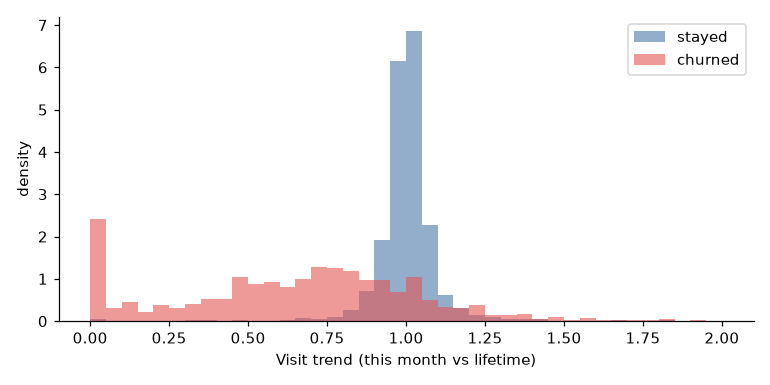
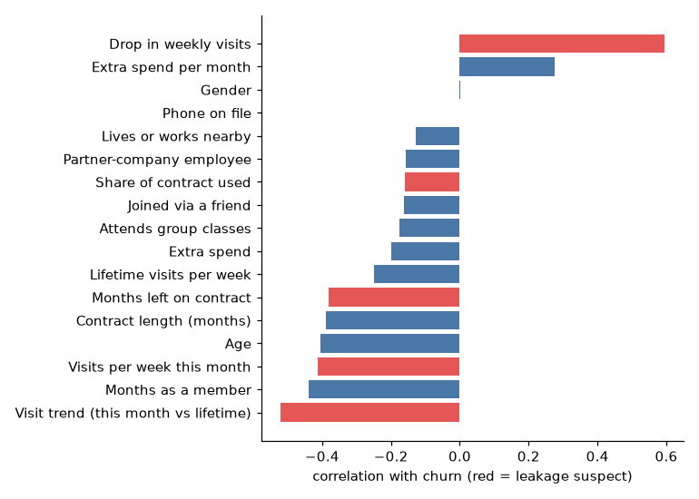

# Data collection and preparation

*Code in `SystemCode/backend/anchorai/scenario/` and `anchorai/features/`; notebooks `a_features_leakage.ipynb` and `a_scenario_uplift.ipynb`. Every number here is reproduced by `uv run anchorai data build` (seed 42) and the notebook named next to it. Figures are in `SystemCode/notebooks/figures/`, tables in `SystemCode/notebooks/results/`.*

## Process

The data and model work followed CRISP-DM (Chapman et al., 2000; RS D2). Each phase maps to a part of this report.

| CRISP-DM phase | Work | Where it is reported |
|---|---|---|
| Business understanding | The weekly decision the data must support: who to contact, with which offer, within budget and staff hours | Business problem |
| Data understanding | Profile the Kaggle snapshot: the label, the class imbalance, and what a single snapshot cannot tell us | This section |
| Data preparation | Split, features, leakage check, and a synthetic scenario layer for what the snapshot lacks | This section |
| Modelling | K-means segments, a calibrated churn ensemble, a T-learner uplift baseline | Knowledge discovery |
| Evaluation | E1 and E2 on real members; uplift recovery against the scenario's ground truth | Experiments E1 and E2 |
| Deployment | One build command, the member APIs and pages, rebuilds from the admin page | Implementation |

## Source data

AnchorAI is built on the public Kaggle dataset *Gym Customers Features and Churn* (Vinueza, CC BY-NC-SA 4.0). The dataset is cited, not redistributed: users download it into `SystemCode/data/raw/` (installation guide).

- **Size and quality:** 4,000 members and 14 columns, with no missing values and no duplicate rows.
- **Label:** `churn` marks members who left. 1,061 members (26.5%) left and 2,939 stayed. A model that predicts "stays" for everyone is 73.5% accurate and catches no churner, so accuracy is not used. E2 reports F1 on the churn class, PR-AUC and the Brier score instead.
- **One snapshot:** each member is one row. The data has no dates, no clubs, classes or instructors, no offers and no record of past retention contacts.

| Group | Column | Values over all 4,000 members |
|---|---|---|
| Profile | `gender` | coded 0 or 1, with no labels in the source; 51% are 1 |
| | `age` | 18 to 41 years, mean 29.2 |
| | `near_location` | 85% live or work near the club |
| | `phone` | 90% have a phone number on file (1 = on file) |
| Membership | `contract_period` | 1, 6 or 12 months; median 1 |
| | `month_to_end_contract` | 1 to 12 months left; median 1 |
| | `lifetime` | months as a member, 0 to 31; median 3 |
| | `partner` | 49% work for a partner company |
| | `promo_friends` | 31% joined through a friend's referral |
| Activity | `group_visits` | 41% attend group classes |
| | `avg_class_frequency_total` | visits per week over the whole membership; mean 1.88 |
| | `avg_class_frequency_current_month` | visits per week this month; mean 1.77 |
| Spend | `avg_additional_charges_total` | spend on other services (café, goods, massage); mean 147 |
| Target | `churn` | 1 = left; 26.5% |

*Source: `a_features_leakage.ipynb`, cell 2.*

## Preparation

1. **Renaming.** Column names are lower-cased to snake case (for example `avg_class_frequency_current_month`). Each row gets a pseudonymous `member_id`, `M0001` to `M4000` in source row order.
2. **Split.** An 80/20 split, stratified on churn, gives 3,200 training members (849 churners) and 800 test members (212 churners). Both have a 26.5% churn rate. Test labels are used only to report metrics. Nothing is fitted on them, and a regression test enforces this: it flips every test label and checks that no member's score changes (`tests/test_discovery.py`).
3. **Synthetic member columns.** The source has no club and no fee, so three columns are added:
   - `club_id`: C1, C2 or C3, assigned at random
   - `monthly_value`: a list price by contract length, $72 a month for 1-month, $54 for 6-month and $46 for 12-month contracts. It is an assumption. It weights the planner's value of keeping a member and the dashboard's revenue at risk.
   - `split`: train or test
4. **Contract.** The column names and types of every table are fixed in `anchorai/scenario/tables.py`, the contract every part of the system codes against (PLAN.md §6). Every build checks primary keys, foreign keys and value rules before it writes anything, for example that every attendance row has more than zero weekly visits, and fails rather than write a broken table. A small synthetic fixture with the same columns (`tests/fixtures/`) let the planner, rules and knowledge graph be built and tested before the real tables existed.

### The data tables

`anchorai data build` writes these tables to `SystemCode/data/generated/`. They are the hand-over from member intelligence to the rest of the system.

| Table | One row per | Main columns | Source | Read by |
|---|---|---|---|---|
| `members` | member | `member_id`, the 14 Kaggle columns, `club_id`, `monthly_value`, `split` | Kaggle plus 3 synthetic columns | every part |
| `instructors`, `classes` | instructor, class | `club_id`, `name`; a class's `instructor_id` | synthetic | knowledge graph, Member 360 |
| `attendance` | member and class | `visits_per_week` (always > 0) | synthetic, consistent with Kaggle visits | knowledge graph, optimiser cohorts, Member 360 |
| `offers` | offer | `cost`, `staff_minutes`, `inventory`, `channels` | synthetic | intervention history; the same catalogue seeds the app |
| `interventions` | past contact | `week_start`, `offer_id`, `channel`, `treated`, `stayed` | synthetic | case base (CBR), T-learner, rule contact facts, Member 360 |
| `events` | gym event | `event_type` (`instructor_left`, `class_cancelled`), `entity_id`, `week_start` | synthetic | knowledge graph |
| `true_uplift` | member and offer | `uplift` | scenario ground truth | plan evaluator (E3–E7) |
| `true_churn` | member | `base_churn`, `event_churn`, `lost_instructor_share`, `cancelled_share`, `churned_no_contact` | scenario ground truth | plan evaluator, E7 |
| `features` | member | the 17 model features | derived from Kaggle | churn model, rule facts, CBR |
| `segments` | segment | name, description, size, churn rate, centre | model output | API and pages |
| `member_scores` | member | `segment_id`, `segment`, `churn_prob`, `risk_band`, `monthly_value`, `club_id`, `top_drivers` (JSON list) | model output | rules, planner, explanations, assistant, knowledge graph |
| `uplift_tlearner` | member and offer | `uplift` | model output | E3 and E4 baseline |

The build also writes `model_card.json` (every metric shown on the Data & models page) and the fitted models (`models/*.joblib`). The knowledge graph's `kg load` adds `kg_facts.parquet`. `member_scores` is the on-disk form of the `MemberScore` contract in `anchorai/schemas.py`: the API builds a `MemberScore` from a row of it plus the member's features.

## Features

The churn model uses 17 features (`anchorai/features/__init__.py`): the 13 Kaggle predictors and four derived from them.

| Feature | Definition | Why |
|---|---|---|
| `trend_ratio` | this month's weekly visits ÷ lifetime weekly visits; 1.0 when there are no lifetime visits; capped at 3 | the proposal's "12 visits a month down to 4" signal: attendance falls before a member cancels |
| `visit_change` | this month's minus lifetime weekly visits; negative means fewer visits than usual | the same signal on an absolute scale |
| `contract_progress` | the share of the contract already used: 1 − months left ÷ contract length | members near the end of a contract are free to leave |
| `charges_per_month` | extra spend ÷ (months as a member + 1) | spend intensity, rather than spend that piles up over a long membership |

Seven features are categorical (`gender`, `near_location`, `partner`, `promo_friends`, `phone`, `group_visits`, `contract_period`) and ten are numeric. The logistic regression standardises the numeric features; LightGBM uses raw values. `contract_period` is in the categorical set so that SMOTE-NC, when it is used, copies a real contract length (1, 6 or 12 months) instead of interpolating one; the models still read it as a number.

**What a snapshot allows.** The proposal planned features in families: recency, frequency, regularity, class engagement, relationship, commercial and lifecycle. The snapshot supports most of them. Recency and regularity need visit dates, which it does not have.

| Family (proposal) | Built from |
|---|---|
| Frequency and trend | lifetime and current-month weekly visits, `trend_ratio`, `visit_change` |
| Class engagement | `group_visits` |
| Relationship | `partner`, `promo_friends`, `near_location` |
| Commercial | `contract_period`, `avg_additional_charges_total`, `charges_per_month` |
| Lifecycle | `lifetime`, `month_to_end_contract`, `contract_progress` |
| Recency, regularity | not possible: no visit dates |

Age, gender and phone complete the set.

**The trend signal on real members.** The median `trend_ratio` is 0.69 for members who left and 1.00 for those who stayed. Members who stayed cluster tightly around 1.0, visiting as usual. Members who left spread out below it, with a spike at 0 for those who did not come at all this month. Leavers are also newer (median 1 month against 4) and closer to the end of their contract (median 1 month left against 6) (`a_features_leakage.ipynb`, cell 4).

## Leakage check

The proposal warned against features that the cancellation itself produces, such as freeze requests or a removed payment method. The Kaggle snapshot has no such fields, but it has a timing risk instead: `avg_class_frequency_current_month` and `month_to_end_contract` may be measured in the same month as the churn label (PLAN.md drift item 5). Together with the three features derived from them (`trend_ratio`, `visit_change`, `contract_progress`), they form the **suspect set** (`SUSPECT` in `anchorai/features`). The set includes the strongest single signals: the two features most correlated with churn, `visit_change` and `trend_ratio`, are both suspect (`a2_feature_correlation.png`).

The same model (same family, imbalance treatment and calibration) was trained with and without the suspect set (`a_features_leakage.ipynb`, `results/a_leakage.csv`):

| Variant | Features | CV F1 | CV PR-AUC | Test F1 | Test PR-AUC | Test Brier |
|---|---|---|---|---|---|---|
| with the suspect set (served) | 17 | 0.906 | 0.972 | 0.908 | 0.973 | 0.035 |
| without the suspect set | 12 | 0.814 | 0.897 | 0.817 | 0.900 | 0.069 |

The suspect columns carry real signal, but the model stays strong without them. The served model keeps them, because both values are known when the weekly plan is made. If the Kaggle label was recorded after that month ended, the second row is the honest estimate. That is why the report shows both. Rules that read `trend_ratio` inherit the same caveat.

## Scenario layer

The knowledge graph, the case-based reasoner, the uplift models and the optimiser need things the Kaggle data lacks. So a **scenario layer** attaches a synthetic gym to the real members (`anchorai/scenario/build.py`). Every parameter is listed in the appendix "Scenario layer parameters" (`a-appendix-scenario-layer.md`).

Segmentation and the churn model (E1, E2) use only real columns. Results that depend on the scenario (the uplift baseline, E3–E7) test whether the system recovers a known structure and makes better decisions against a known ground truth. They are not claims about how real members respond.

**Gym structure.** 3 clubs, each with 3 instructors who teach 2 classes: 9 instructors and 18 classes. The 1,611 members who attend group classes are spread over 1 to 3 classes at their own club. Their weekly class visits add up to their real Kaggle visit frequency, so the synthetic timetable never contradicts the real data. Members who do not attend classes, or whose frequency is zero, have no attendance rows.

**Offers.** Four retention offers, each with a cost, staff time, weekly stock, the channels it can use and the staff skill it needs. The same catalogue seeds the app's offer table, which admins can edit on the Offers & constraints page.

| Offer | Cost | Staff minutes | Weekly stock | Channels |
|---|---|---|---|---|
| Personal check-in message | $0 | 5 | unlimited | SMS, email, call |
| Free personal training session | $40 | 60 (trainer) | 40 | call, in person |
| Bring-a-friend class pass | $15 | 10 | 100 | SMS, email, call |
| One month at 20% off | $12 | 15 | unlimited | email, call |

**Ground truth.**
- **Hazard:** each member has a synthetic churn hazard for the next month, without contact. It is computed from features only, never from the real label. As a plausibility check, it correlates 0.715 with the real churn label (`a_scenario_uplift.ipynb`, cell 4).
- **Offer effects:** each offer has a documented, heterogeneous effect on next-month retention. A PT session helps new members most, a class pass helps class-goers, and a discount helps price-sensitive monthly members but backfires on annual ones.
- **`true_uplift`:** the resulting gain in stay probability for every member and offer, 16,000 pairs with a mean of +5.8 points.

**Gym events.**
- **What happens:** in the week before the scoring date, the instructor with the most attendees leaves (Maya Chen, who teaches Zumba and Core at club C2), and the busiest class at another club is cancelled (HIIT at C1).
- **Effect:** an event raises the hazard of the members it touches, in proportion to the share of their class visits it hits (`true_churn`).
- **Why it matters:** the churn model cannot see the event, because the Kaggle snapshot has none; only the knowledge graph can. For the 186 members who did at least half their class visits with the departed instructor, the hazard rises 1.80 times (`results/a5_event_lift.csv`).

**Intervention history.** 2,400 past contacts, in the 12 weeks before the scoring date. 1,416 members were given a random offer through a random allowed channel; the other 984 are untreated controls. Outcomes follow the ground truth in force that week. Because assignment is random, uplift estimators face heterogeneity and sample size, not confounding. Treated members stay 4.9 points more often than controls (`a_scenario_uplift.ipynb`, cell 2):

| Arm | Contacts | Stayed |
|---|---|---|
| no contact (control) | 984 | 67.0% |
| check-in message | 354 | 67.8% |
| one month at 20% off | 341 | 71.0% |
| class pass | 368 | 71.2% |
| free PT session | 353 | 77.6% |
| all treated | 1,416 | 71.9% |

## Reproducibility

- **One command.** `uv run anchorai data build` regenerates every table, model and score from the raw CSV in about 20 seconds (`anchorai/pipeline.py`).
- **One seed.** Every random step takes `ANCHORAI_SEED` (default 42): the split, club assignment, attendance, the intervention history, K-means, the cross-validation folds, SMOTE-NC and LightGBM. The events follow from the attendance (the busiest instructor and class), so they need no randomness of their own. Two builds with the same seed give identical tables (`tests/test_build.py`).
- **Frozen inputs.** The code that builds the tables and models has not changed since 17 October 2026, so every experiment ran on the same tables.
- **From the app.** An admin can upload a new Kaggle CSV and rebuild with any seed on the Data & models page. A different seed changes every number in the experiments, and the page warns about this.

## Changes from the proposal

The full list is in `docs/PLAN.md` §4 and the course-mapping appendix. These are the ones that concern data.

| Proposal or deck | Built | Why |
|---|---|---|
| An agent-based longitudinal simulator | The real Kaggle members plus a thin scenario layer (drift item 2) | Lower risk, and churn and segmentation stay results on real data |
| SMOTE-NC to a 50/50 balance, about 1,500 synthetic churners (deck) | SMOTE-NC compared with class weights inside cross-validation; class weights kept; Platt calibration (drift item 3) | Oversampling inflates the probabilities that the planner multiplies by uplift and value |
| Recency and regularity features | Not built | The snapshot has no visit dates |
| Censoring of members still active | Dropped (drift item 12) | A single snapshot with a binary label has no observation window to censor |
| Leakage: exclude cancellation-process fields | A with/without check on same-month columns | The snapshot has no cancellation fields; its risk is timing |

## References

- Chapman, P., Clinton, J., Kerber, R., Khabaza, T., Reinartz, T., Shearer, C. and Wirth, R. (2000). *CRISP-DM 1.0: Step-by-step data mining guide*. SPSS.
- Chawla, N. V., Bowyer, K. W., Hall, L. O. and Kegelmeyer, W. P. (2002). SMOTE: Synthetic minority over-sampling technique. *Journal of Artificial Intelligence Research*, 16, 321–357.
- Vinueza, A. *Gym Customers Features and Churn* [dataset]. Kaggle. CC BY-NC-SA 4.0. https://www.kaggle.com/datasets/adrianvinueza/gym-customers-features-and-churn
