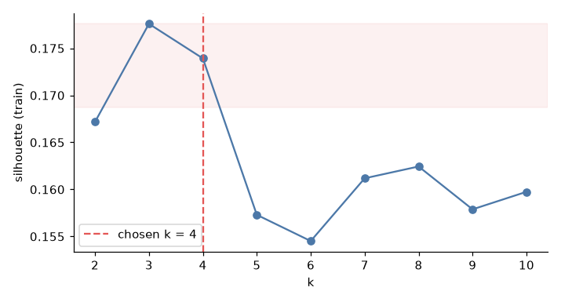
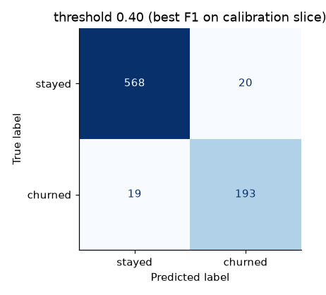
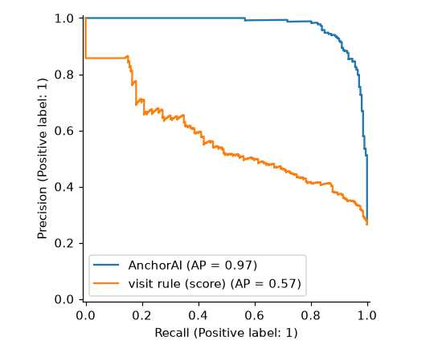
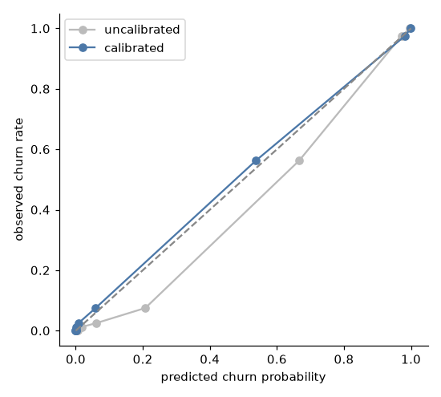
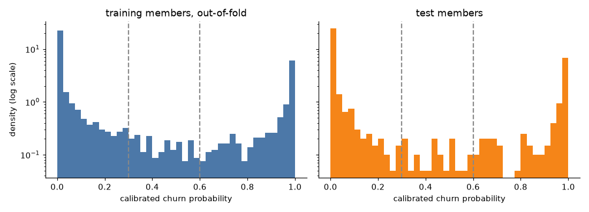

# Experiments E1 and E2 (real data)

*Both experiments use only the real Kaggle members. Reproduce them with `uv run anchorai data build` (seed 42), then `notebooks/a_segmentation.ipynb` and `notebooks/a_churn.ipynb`. Both notebooks import their logic from `anchorai`. Figures are in `notebooks/figures/`, tables in `notebooks/results/`.*

| Experiment | Question | Data | Baseline |
|---|---|---|---|
| E1 | Are the segments meaningful? | 3,200 training members (fit), all 4,000 (assignment) | every k from 2 to 10 |
| E2 | Does the churn model beat simple rules? | 3,200 training members (fit and calibration), 800 untouched test members (metrics) | a visit-threshold rule; a single logistic regression |

## E1: Are the segments meaningful?

**Method.** K-means on seven standardised behavioural features, fitted on the training split for k = 2 to 10. Three measurements:

- silhouette on the training split
- stability: the adjusted Rand index (ARI) against five other random seeds
- how sharply the segments separate churn, which the clustering never sees

A useful segmentation, for a retention team, is one that is chosen by a fixed rule, comes out the same whatever the random start, carries over to unseen members, and separates members by risk in a way staff can name.

**Silhouette by k** (`e1_silhouette.png`, `results/e1_silhouette_by_k.csv`):

| k | 2 | 3 | **4** | 5 | 6 | 7 | 8 | 9 | 10 |
|---|---|---|---|---|---|---|---|---|---|
| silhouette | 0.167 | 0.178 | **0.174** | 0.157 | 0.155 | 0.161 | 0.162 | 0.158 | 0.160 |

**Results.**
- **Choice of k:** silhouette is low and nearly flat, as expected for behavioural data without clean clusters. The documented rule (the most detailed k within 5% of the best) chooses **k = 4** (silhouette 0.174).
- **Stability:** very high. The mean ARI across seeds is 1.00 (minimum 0.998), so the same members land in the same segments whatever the initialisation.
- **Generalisation:** the test split falls into the segments in proportions similar to the training split, within 4.2 percentage points for every segment (`a_segmentation.ipynb`, cell 7).
- **Churn separation:** sharp. Churn rates run from 94.6% (New and slipping) through 17.4% and 12.6% down to 1.4% (Annual-contract loyalists). The profiles are in the knowledge discovery section (`e1_profiles.png`, `results/e1_segment_profiles.csv`).

**Finding.** The segments are not geometrically crisp, but they are stable, interpretable, and separate risk by a factor of almost 70. That is what a retention team needs from them.

## E2: Does the churn model beat simple rules?

**Method.** All metrics are on the 800 untouched test members (`results/e2_model_vs_baselines.csv`). The churn class is the positive class. F1 uses each model's own threshold: the calibrated ensemble uses 0.404, chosen on the calibration slice, and the logistic regression uses 0.5. A model that beats the baselines should do so on all three of:

- **F1** on the churn class: the quality of the yes-or-no flag
- **PR-AUC**: how well members are ranked by risk, which suits an imbalanced label
- **Brier score**: the accuracy of the probabilities themselves, which the planner consumes

**Baselines:**
- a single class-weighted logistic regression
- a visit rule: "churn if visits per week this month ≤ 1.63", with the threshold chosen on the training split

| Model | F1 | Precision | Recall | PR-AUC | ROC-AUC | Brier |
|---|---|---|---|---|---|---|
| **AnchorAI ensemble, calibrated** | **0.908** | 0.906 | 0.910 | **0.973** | 0.988 | **0.035** |
| Single logistic regression | 0.862 | 0.818 | 0.910 | 0.953 | 0.978 | 0.056 |
| Visit rule (≤ 1.63 visits a week) | 0.549 | 0.426 | 0.774 | 0.390 | 0.699 | 0.336 |

The visit rule's PR-AUC in the table is that of a yes-or-no flag. Used instead to rank members by this month's visits, it reaches an average precision of 0.57 (`e2_pr_curve.png`). Either way it is far below the model's 0.97.

**Confusion matrix** (threshold 0.404, `e2_confusion.png`): 193 true positives, 19 missed churners, 20 false alarms and 568 true negatives. Of the 212 test members who left, the model flags 193. About 1 in 11 of its flags is a member who stayed.

**Imbalance treatment** (5-fold CV on the training split, `results/e2_resampling_cv.csv`):

| Treatment | F1 | PR-AUC | Brier |
|---|---|---|---|
| SMOTE-NC inside each training fold | 0.905 | 0.970 | 0.039 |
| class weights (chosen) | 0.906 | 0.972 | 0.039 |

The two are equivalent here. Class weights won the documented tie-break (PR-AUC first) and are simpler.

**Leakage check** (`results/e2_leakage_test.csv`): without the five suspect columns, test F1 falls to 0.817 and PR-AUC to 0.900. Both versions are reported: the served one, and the honest lower bound if the current-month columns were recorded after the churn month.

**Calibration** (`e2_calibration.png`, `results/e2_reliability_by_band.csv`). Before calibration, the class-weighted ensemble over-predicts churn in the middle of the range. Platt calibration moves the curve onto the diagonal, and each risk band churns at about its predicted rate:

| Band (test) | Members | Mean predicted | Observed churn |
|---|---|---|---|
| low (< 0.3) | 579 | 1.6% | 2.9% |
| medium (0.3–0.6) | 24 | 44.1% | 41.7% |
| high (≥ 0.6) | 197 | 95.1% | 93.9% |

**Why the probabilities are so extreme** (`e2_score_distribution.png`, `results/e2_score_distribution.csv`).
- Most members score near 0 or near 1. This is a property of the data, not an artefact: a few columns (tenure, months left on the contract, this month's visits) nearly decide the outcome, and the bands above show the extremes are honest.
- The test split, scored out-of-sample, is as extreme as the training split. Training members are scored out-of-fold, so their error rate at 0.5 (4.9%) matches the test split (4.6%).
- One consequence for the rule base is that the medium band is small: 169 of 4,000 members. `results/e2_band_cutoffs.csv` lists band sizes for lower medium cut-offs, from 267 members at 0.2 to 571 at 0.05.

**Drivers.** By mean absolute SHAP value on the test split, the LightGBM component relies most on the change in weekly visits, tenure and age, followed by visit trend and extra spend (`e2_shap.png`, in the knowledge discovery section). This matches the segment profiles: the high-churn segment is new, younger, and visiting much less this month.

**Fairness on the test set** (`results/e2_fairness.csv`):

| Group | Members | Churn rate | Recall | False-positive rate |
|---|---|---|---|---|
| age 18–25 | 108 | 61.1% | 0.985 | 0.143 |
| age 26–30 | 425 | 28.9% | 0.943 | 0.043 |
| age 31+ | 267 | 8.6% | 0.522 | 0.004 |
| gender 0 | 389 | 26.0% | 0.861 | 0.045 |
| gender 1 | 411 | 27.0% | 0.955 | 0.023 |

- **Age:** the largest gap (recall gap 0.46). Churn among members aged 31 and over is rare (23 churners in the test split), and the model misses about half of them. This is reported rather than hidden. A mitigation for staff is to review medium-risk members in that band, or to use a lower review threshold for them. The youngest band shows the opposite trade-off: almost every churner is caught, at a false-positive rate of 14%.
- **Gender:** the gap is small (recall 0.86 against 0.95). Gender is coded 0/1 in the source data, with no labels.

**Finding.** The calibrated ensemble clearly beats both baselines on every metric:
- F1 0.908 against 0.862 for logistic regression and 0.549 for the visit rule
- PR-AUC 0.973 against 0.953 and 0.390
- Brier 0.035 against 0.056 and 0.336

Its probabilities are calibrated, so the optimiser can multiply them by uplift and value at face value.

## Input to E3: the uplift baseline

The T-learner baseline (`notebooks/a_scenario_uplift.ipynb`, `results/a6_tlearner_recovery.csv`) recovers the scenario's ground-truth uplift ranking with Spearman ρ = 0.39 overall and 0.61 for PT sessions. The Qini curve in `a6_qini.png` lies well above random targeting but well below the oracle. The case-based estimator is compared against it in E3: the two tie on ranking, and at the seeded 36 staff hours plans built on the T-learner keep slightly more members (24.6 against 21.0 extra); with more staff time the two are level. The method and the comparison are in the knowledge discovery section, and the scenario's sanity checks in the scenario appendix.

## Summary

| Experiment | Answer | Evidence |
|---|---|---|
| E1 | Yes: stable, interpretable segments that separate risk, though not crisp clusters | k = 4 by a fixed rule; silhouette 0.174; ARI 1.00 across seeds; churn from 94.6% to 1.4% |
| E2 | Yes: the ensemble beats both baselines on every metric, with calibrated probabilities | test F1 0.908, PR-AUC 0.973, Brier 0.035; observed churn within 3 points of the predicted rate in every band |

## Limitations

- **One real snapshot.** The Kaggle data is a single snapshot with one binary label, so there is no out-of-time validation. The test split is a random 20% of the same snapshot.
- **Leakage uncertainty.** The leakage question cannot be settled from the data alone, which is why both models are reported.
- **Small groups.** The medium band has 24 test members and the 31+ age band 23 test churners, so their calibration and recall are measured on few members.
- **Synthetic scenario.** Everything that depends on the scenario layer (uplift, gym events, intervention history) is synthetic and documented in the scenario appendix. Results built on it measure recovery of known structure, not real member behaviour.
