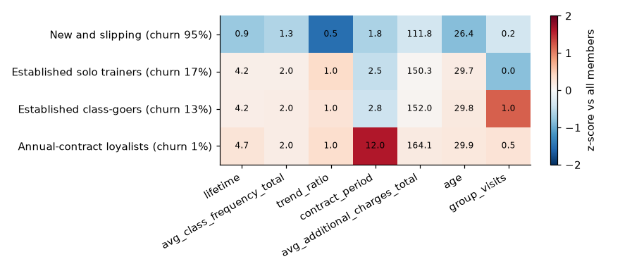
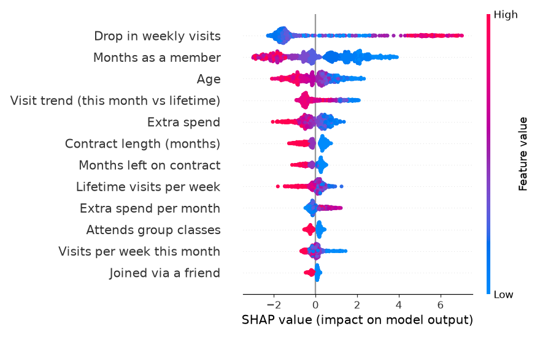
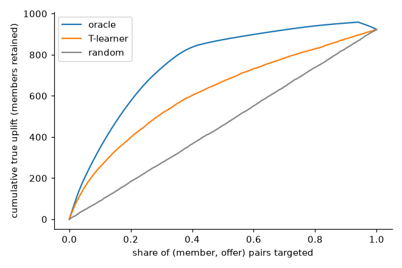

# Knowledge discovery: segmentation, churn and an uplift baseline

*Code in `SystemCode/backend/anchorai/discovery/`; notebooks `a_segmentation.ipynb` (E1), `a_churn.ipynb` (E2) and `a_scenario_uplift.ipynb` (uplift baseline). This section explains the methods and the choices behind them. The measured results are in the experiments section (E1 and E2).*

Knowledge discovery gives every member three things:

1. a **segment**: a plain-English group of members who use the gym in a similar way
2. a calibrated **churn probability** for next month, with a risk band and the five factors that drive it
3. an **uplift estimate** for each offer: how much a contact would raise the chance that the member stays

`anchorai data build` writes them to `member_scores.parquet` and `uplift_tlearner.parquet`. The API serves them as `MemberScore`, the contract between member intelligence and the rest of the system (`anchorai/schemas.py`).

**Flow.** Kaggle CSV → data tables and 17 features → K-means (segment) and the calibrated ensemble (probability, band, drivers) → `MemberScore` → rule engine, planner, explanations, assistant and knowledge graph. In parallel, the T-learner learns uplift from the scenario's intervention history.

## Behavioural segmentation (K-means)

**Purpose.** Staff think in groups, for example "new members who have stopped coming". Segments give the dashboard, the member list and Member 360 that vocabulary. They describe behaviour. They are not an input to the churn model, and no decision rule depends on them.

**Input.** Seven behavioural features, standardised:

- months as a member, log-scaled because it is long-tailed (0 to 31 months, median 3)
- lifetime weekly visits
- visit trend (`trend_ratio`)
- contract length
- extra spend
- age
- group-class attendance

The churn label is not used: each segment's churn rate is computed only after the clusters are fixed. `trend_ratio` is in the leakage-suspect set (data preparation), so the "New and slipping" segment shares that caveat.

**Fitting.**
- K-means is fitted on the training split only. Every member is then assigned to the nearest centre.
- Each k from 2 to 10 is fitted with 10 initialisations and scored by silhouette (Rousseeuw, 1987) on the training split.
- Stability is the adjusted Rand index (Hubert and Arabie, 1985) between the chosen clustering and five refits with other seeds.

**Choosing k.** Silhouette is low and almost flat on this data (0.155 to 0.178), so it cannot pick k alone. The rule in `choose_k` is to take the most detailed k between 3 and 8 whose silhouette is within 5% of the best. This gives **k = 4** (silhouette 0.174, against the best of 0.178 at k = 3). k = 4 adds a distinct annual-contract segment that k = 3 merges away. The proposal also planned a Gaussian mixture model. It was dropped so that segmentation matches the deck and MR D4.

**Naming.** Segments are ordered by churn rate and named by fixed rules on their centres (`name_segment`), so the names survive a rebuild with another seed or a new data file:

| Rule on the segment centre, checked in order | Name |
|---|---|
| under 2 months as a member, and visits this month below 0.8 × the usual rate | New and slipping |
| under 2 months, with steady or rising visits | New and settling in |
| average contract of 9 months or more | Annual-contract loyalists |
| under 1.3 visits a week | Established but infrequent |
| at least half attend group classes | Established class-goers |
| otherwise | Established solo trainers |

With seed 42, four of these names occur. A one-line description is generated from each centre (`describe_segment`), and the Segments page shows it.

| Segment | Members | Churn rate | Typical member |
|---|---|---|---|
| New and slipping | 728 | 94.6% | 0.9 months in, visits down 52% this month |
| Established solo trainers | 1,365 | 17.4% | 4.2 months, no group classes |
| Established class-goers | 961 | 12.6% | 4.2 months, all attend classes |
| Annual-contract loyalists | 946 | 1.4% | 12-month contracts |

**Where segments are used.** The dashboard's segment mix, the Segments page, the segment filter on the Members list, the "Profile vs segment" table on Member 360, the member nodes of the knowledge graph, and the rule engine's `segment` fact, which no rule reads today.

## Churn model

**Model.** The mean of two classifiers over the 17 features (`discovery/churn.py`):

- a logistic regression on standardised numeric features, class-weighted
- LightGBM (Ke et al., 2017): 300 trees, learning rate 0.03, 15 leaves, at least 20 members per leaf, 80% row and column subsampling, class-weighted

The logistic regression is stable and easy to read. LightGBM can model non-linear effects and interactions that a linear model cannot. Their averaged probability is then calibrated. This is the ensemble the proposal named: gradient boosting plus logistic regression, calibrated.

**Data use.** The models are fitted on 80% of the training split (2,560 members). The other 20% (640) is held out for calibration and the decision threshold. The test split is not touched until evaluation.

**Class imbalance (26.5% churn).**
- Two treatments were compared with 5-fold cross-validation on the training split:
  - SMOTE-NC oversampling (Chawla et al., 2002), applied inside each training fold through an `imblearn` pipeline, so that no synthetic row leaks into a validation fold
  - class weights
- They score almost the same (out-of-fold PR-AUC 0.970 against 0.972; Brier 0.039 for both). Class weights were kept on the documented tie-break, PR-AUC first and then Brier. They are also simpler: no synthetic members.

**Calibration.**
- SMOTE and class weights both distort probabilities: a model trained as if churners were common predicts churn too often. The optimiser multiplies probability × uplift × value, so a distorted probability silently distorts the plan.
- So a Platt calibrator (Platt, 1999), a logistic regression on the log-odds of the ensemble's probability, is fitted on the held-out 20% of the training split, never on the test set.
- Platt scaling suits a calibration slice this small. Isotonic regression, the usual alternative, tends to overfit when calibration data are scarce, where a two-parameter fit does not (Niculescu-Mizil and Caruana, 2005).

**Threshold and risk bands.**
- The decision threshold (0.404) maximises F1 on the calibration slice. E2's F1 and confusion matrix use it.
- Staff see bands rather than a threshold: **high** for 0.6 or more, **medium** for 0.3 to 0.6, **low** below 0.3 (`RISK_BANDS` in `discovery/scores.py`). The bands are always shown as text and colour, never colour alone, and a probability is never shown as 0% or 100%.
- The rule base reads the band; for example, guardrail G04 blocks paid offers for low-risk members (*Decision automation*).
- Because the probabilities are calibrated, a band means what it says: on the test split, high-band members churn at 93.9% against a predicted 95.1% (E2).

**Scores for every member.**
- Test members are scored by the final model.
- Each training member is scored **out-of-fold**, by a model fitted on the other four folds, so no member's score has seen its own label. In-sample scoring had made training members look easier to predict than they are: an error rate of 2.8% at 0.5, against 4.6% on test. Out-of-fold it is 4.9% against 4.6% (`results/e2_score_distribution.csv`).
- A regression test checks that changing one training member's label never changes that member's score (`tests/test_discovery.py`).

**Explanations.**
- For each member, the five largest contributions, in log-odds, become the "Why this risk score" chart on Member 360 and the `top_drivers` field of `MemberScore`.
- Each contribution is the average of two terms. One is the logistic regression's term: its coefficient times the member's standardised deviation from the training mean. The other is LightGBM's exact tree SHAP value (Lundberg and Lee, 2017; Lundberg et al., 2020).
- A positive value pushes towards churn, a negative one towards staying. The screen says that these explain the model's estimate and are not proof of cause.

**Fairness.** Recall and false-positive rate are measured by age band and by gender on the test split, and shown on the Data & models page. The largest gap is recall for members aged 31 and over (0.52), where churn is rare. E2 reports it with a mitigation for staff.

**Outputs and who uses them.**

| Output | Stored in | Used by |
|---|---|---|
| `churn_prob`, `risk_band` | `member_scores.parquet`, `MemberScore` | rule facts; the risk-top-k baseline and plan explanations; dashboard, member list, Member 360; assistant; knowledge-graph member nodes |
| `segment` | the same | pages, rule facts, knowledge graph |
| `top_drivers` (five signed log-odds contributions) | the same | Member 360's driver chart; plan explanations and staff talking points; the assistant's `member_risk` answers |
| model card: metrics, calibration, fairness, silhouette | `model_card.json` | Data & models page (W42), Settings health page (W45) |

## Uplift baseline (T-learner)

**Why uplift.** A churn score says who is likely to leave, not whom a contact would keep. Ascarza (2018) showed on field data that targeting by expected response to the intervention reduces churn more than targeting by risk (business problem section). The planner therefore spends on uplift: the change in stay probability that an offer causes.

**Method.** The T-learner (Künzel et al., 2019) is the simplest meta-learner for this: one outcome model per arm (`discovery/uplift.py`).
- There is one model per offer and one for the untreated controls, each trained on the scenario's intervention history. The arms hold 341 to 368 treated members per offer and 984 controls.
- Each arm model is a mean of a logistic regression and a small LightGBM (150 trees, 7 leaves).
- A member's uplift for an offer is the predicted stay probability under that offer minus the prediction under no contact.

The courses do not teach uplift modelling; the T-learner is self-researched (MR D4 extension). It is the baseline that the case-based estimator is compared with in E3.

**Result.** Against the scenario's ground truth, over all 16,000 member and offer pairs (`results/a6_tlearner_recovery.csv`):

| Offer | Spearman ρ with the true uplift | Mean true uplift | Mean estimate |
|---|---|---|---|
| Free PT session | 0.61 | +11.6 pts | +10.7 pts |
| Class pass | 0.34 | +5.4 pts | +7.5 pts |
| One month at 20% off | 0.27 | +3.1 pts | +4.8 pts |
| Check-in message | 0.26 | +2.9 pts | +2.4 pts |
| All pairs | 0.39 | +5.8 pts | +6.4 pts |

- It does best for PT sessions, whose true effect is the largest and most structured, and worst for check-in messages, whose true effect is small.
- Ranked by its estimates, its Qini curve lies well above random targeting but well below the oracle (`a6_qini.png`).
- The ground truth covers all 4,000 members, 60% of whom appear once in the history the model learned from. The out-of-fold check on the history itself is part of E3.

**Compared with case-based reasoning (E3, `results/e3_uplift_vs_truth.csv`, `results/e3_plan_quality.csv`).**
- **Ranking:** the two tie over all pairs (Spearman 0.39 each). CBR is better for the PT session (0.64 against 0.61) and the discount (0.48 against 0.27). It gives the same estimate to every member for the check-in message and the class pass, where the T-learner still ranks them (0.26 and 0.34).
- **Plans:** at the seeded 36 staff hours and a $1,500 budget, a greedy plan built on T-learner estimates keeps 24.6 extra members by the true uplift, against 21.0 on CBR estimates. Staff time runs out first there, so the plans lean on check-in messages, which CBR cannot rank. At 72 and 120 staff hours CBR is level or slightly ahead (36.6 against 35.1, and 51.9 against 50.7).
- **On the history itself:** on the realised outcomes, out of fold, neither estimator beats random targeting (`results/e3_history_qini.csv`). The ranking signal shows against the ground truth, but 2,400 noisy yes-or-no outcomes cannot confirm it.

The team kept CBR as the live planner's estimator (`optimisation/model.load_instance`), because each of its estimates is backed by past cases staff can inspect. The T-learner stays the benchmark: every data build refreshes its estimates, which E3 and E4 use.

## References

- Ascarza, E. (2018). Retention futility: targeting high-risk customers might be ineffective. *Journal of Marketing Research*, 55(1), 80–98.
- Chawla, N. V., Bowyer, K. W., Hall, L. O. and Kegelmeyer, W. P. (2002). SMOTE: Synthetic minority over-sampling technique. *Journal of Artificial Intelligence Research*, 16, 321–357.
- Hubert, L. and Arabie, P. (1985). Comparing partitions. *Journal of Classification*, 2(1), 193–218.
- Ke, G., Meng, Q., Finley, T., Wang, T., Chen, W., Ma, W., Ye, Q. and Liu, T.-Y. (2017). LightGBM: A highly efficient gradient boosting decision tree. *Advances in Neural Information Processing Systems*, 30.
- Künzel, S. R., Sekhon, J. S., Bickel, P. J. and Yu, B. (2019). Metalearners for estimating heterogeneous treatment effects using machine learning. *Proceedings of the National Academy of Sciences*, 116(10), 4156–4165.
- Lundberg, S. M. and Lee, S.-I. (2017). A unified approach to interpreting model predictions. *Advances in Neural Information Processing Systems*, 30.
- Lundberg, S. M., Erion, G., Chen, H., DeGrave, A., Prutkin, J. M., Nair, B., Katz, R., Himmelfarb, J., Bansal, N. and Lee, S.-I. (2020). From local explanations to global understanding with explainable AI for trees. *Nature Machine Intelligence*, 2(1), 56–67.
- Niculescu-Mizil, A. and Caruana, R. (2005). Predicting good probabilities with supervised learning. *Proceedings of the 22nd International Conference on Machine Learning*, 625–632.
- Platt, J. (1999). Probabilistic outputs for support vector machines and comparisons to regularized likelihood methods. In *Advances in Large Margin Classifiers*, MIT Press, 61–74.
- Rousseeuw, P. J. (1987). Silhouettes: a graphical aid to the interpretation and validation of cluster analysis. *Journal of Computational and Applied Mathematics*, 20, 53–65.
