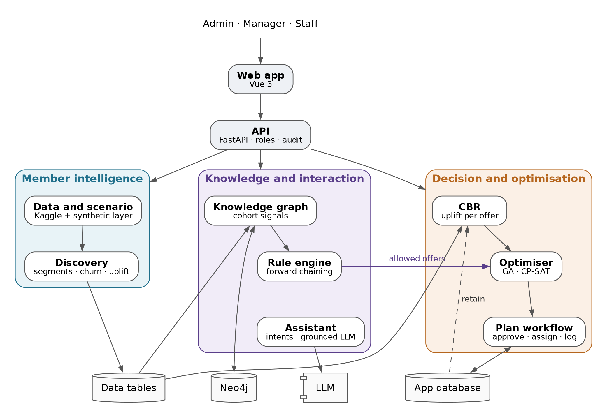
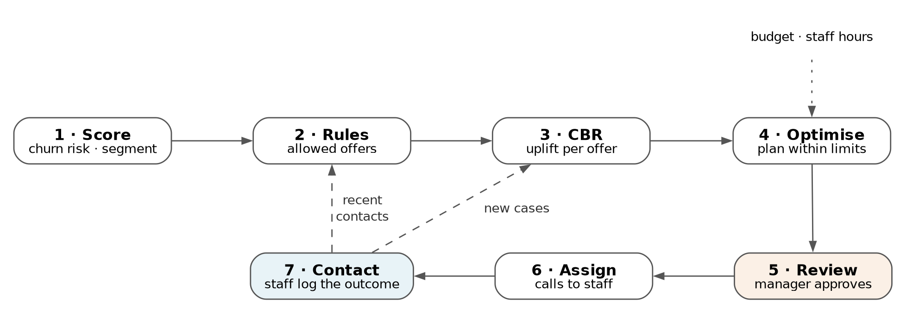

# System design and architecture

AnchorAI turns one weekly question, *which members should we contact this week, with which offer, within our budget and staff hours?*, into an approved call list that every staff member can act on and every manager can question. This section shows how the parts fit together. The sections that follow describe each part in depth.

## Overview

*Figure 1. AnchorAI architecture. Arrows show the direction data flows; double-headed arrows read and write; the dashed arrow is the learning loop, where logged outcomes return to the case base.*

The system has four layers:

1. **Web app.** One application for three roles: admin, manager and staff.
2. **API.** One FastAPI service that checks each user's role, records every change and runs long jobs in the background.
3. **Three reasoning components**, each built around the techniques that suit its job:

| Component | What it does | Main techniques |
|---|---|---|
| Member intelligence | Prepares the real member data, adds a synthetic gym around it (clubs, classes, instructors, offers and a contact history with known effects), and scores every member | Data preparation, K-means segmentation, a calibrated churn ensemble (logistic regression + LightGBM), per-member drivers, a T-learner uplift baseline |
| Knowledge and interaction | Encodes the gym's policies and relationships, and answers staff questions | Forward-chaining rule engine with guardrails and playbooks, a Neo4j knowledge graph, an intent-based assistant that grounds an LLM in tool output |
| Decision and optimisation | Estimates what each offer would achieve for each member and chooses the best plan within the week's limits | Case-based reasoning, a genetic algorithm, CP-SAT constraint optimisation, a greedy baseline and a policy evaluator |

4. **Stores.**
   - **Data tables** (parquet files) hold the members, their scores and the synthetic gym. They are rebuilt from code with one command and a fixed seed.
   - **The app database** (SQLite) holds everything users create: plans, assignments, outcomes, rule versions, offers, the staff roster and the audit log.
   - **Neo4j** holds the knowledge graph.
   - **The LLM** is any OpenAI-compatible endpoint, local (Ollama) or hosted.

## How the parts connect

The figure shows only the main links. In full:

- **Data tables as the shared contract.** The data build writes them once; every other part reads them. Their column names and types are fixed in code and checked on every build, so a change in one part cannot silently break another.
- **Rules decide what is allowed.** For each member, the rule engine reads their scores and features, their recent contacts from the app database, and the signals from the knowledge graph (for example, *their regular instructor has left*). It returns the offers and channels that member may receive, and the trace of rules that fired. Guardrails, such as contact limits or no SMS without a phone number, are therefore hard constraints: the optimiser never sees an offer the rules block.
- **CBR estimates what each allowed offer would achieve.** For each member and allowed offer, the case-based reasoner finds similar members among 2,400 past cases from a randomised trial (1,416 members who received an offer and 984 who were not contacted) and compares those who received the offer with those who did not. The difference is the offer's *uplift*: the extra chance that this member stays.
- **The optimiser chooses the plan.** It picks at most one offer per member to maximise members kept, within the budget, staff minutes, offer stock and contact limits. Class groups from the knowledge graph let it value contacting members who train together, and discount several contacts from the same instructor's classes.
- **Every plan item carries its own explanation.** It holds the churn probability and top drivers, the rule trace and graph signals, the ten most similar past cases with what happened to them, and a one-line summary. The same record appears in the plan's "why" drawer, on the member's page and in the assistant's answers, so every screen gives the same reason.
- **The assistant works only from these sources.** It reads plans, explanations, rules and the graph through fixed tools. The LLM only phrases the answer, and the assistant says when no source supports one.

## The weekly cycle

*Figure 2. The weekly cycle. Steps 1–4 run automatically; the manager reviews and approves (orange), and staff contact members and log outcomes (blue). Dashed arrows carry this week's outcomes into next week's plan.*

1. **Score.** Every member has a churn probability, a segment and the drivers behind their risk.
2. **Rules.** The rule engine lists each member's allowed offers and channels.
3. **CBR.** The case-based reasoner estimates the uplift of each allowed offer.
4. **Optimise.** The manager sets the week's budget and staff hours and chooses a planner: the genetic algorithm by default, exact CP-SAT, or greedy. The plan is built in the background with a progress bar.
5. **Review.** The manager opens "why" on any member, removes or adds contacts with a reason (the rules are re-checked at once), and can re-optimise what is left of the budget. Approving locks the plan; only one plan per week can be approved.
6. **Assign.** Approval shares the calls among staff by their weekly hours and skills; free personal-training sessions go to trainers. Managers can move calls by drag and drop and print a call sheet for each staff member.
7. **Contact.** Staff see their calls in priority order with talking points and an editable message draft, and log each outcome in two taps.

The outcomes feed the next week in two ways. Recent contacts count toward the contact limits, so a member contacted this week is not contacted again too soon. Accepted and declined offers also become new cases for the reasoner. These logged cases are used as similar-case evidence, but the average effect of each offer is still taken only from the randomised history: the planner chooses who is contacted, so outcomes from its own plans would bias that average.

## Technology

| Layer | Technology |
|---|---|
| Web app | Vue 3, TypeScript, Vite, PrimeVue, ECharts (charts), Cytoscape.js (graphs), Pinia (state) |
| API | Python 3.12, FastAPI, JWT sign-in with bcrypt-hashed passwords |
| App database | SQLite through SQLModel; Alembic migrations; deterministic seed data, including a demo week |
| Data and models | pandas, scikit-learn, imbalanced-learn, LightGBM |
| Optimisation | DEAP (genetic algorithm), Google OR-Tools CP-SAT |
| Knowledge graph | Neo4j 5 (Docker), parameterised Cypher queries |
| Assistant | sentence-transformers (intent detection), an OpenAI-compatible client |

## Design principles

- **People decide; the system recommends.** Nothing reaches a member without a manager's approval and a staff member's call. Message drafts are never sent automatically.
- **Explainable by construction.** Every recommendation carries the rules that allowed it, the precedents that support it and the drivers behind the member's risk.
- **Role-based access, enforced twice.** The web app hides what a role cannot use, and the API checks the role again on every request. Staff see only their own calls.
- **Every change is audited.** Plan approvals, overrides, assignments, outcomes and rule or user edits record who, when, what changed and its value before and after.
- **Reproducible.** Every random process takes a seed (42 by default). The data tables, models and demo data are rebuilt from code. The 194 automated tests run offline in about 20 seconds.
- **Works when a service is down.** Without Neo4j, the rules use the graph facts cached at the last load. Without the LLM, the assistant replies with the same cited evidence in a fixed template. The planner needs neither.
- **One component, one job.** Each component sits behind its own API routes and agreed data formats, so it can be tested and replaced on its own.
