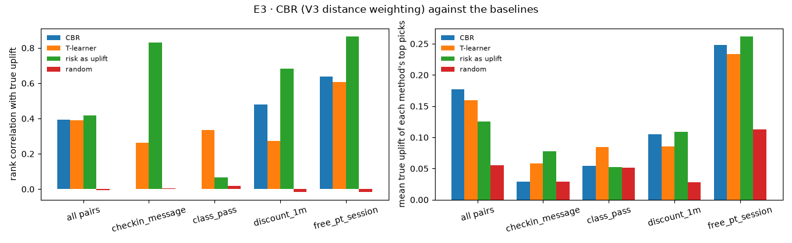
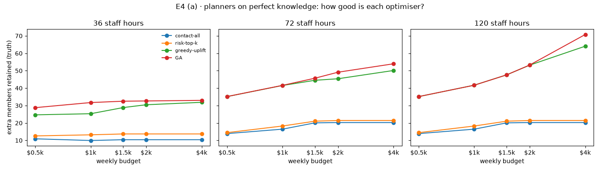
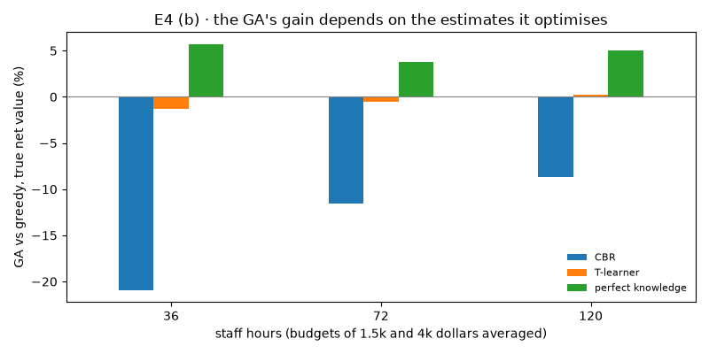
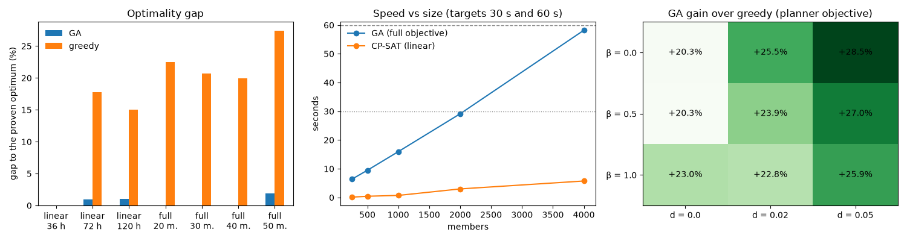

# Experiments E3 to E5 (uplift, plans, optimiser)

*Reproduce with `uv run anchorai setup` (seed 42), then the notebooks `b_plan_model`, `b_cbr`, `b_ga` and `b_exact` in `SystemCode/notebooks/`. Tables are in `notebooks/results/`, figures in `notebooks/figures/`. Run on 22 October 2026.*

All three experiments use the scenario layer. Its true effects, the extra chance each member stays if given each offer (`true_uplift`), are known but are used **only to grade**. No estimator or planner ever reads them. CBR never uses a member's own past case to estimate their effect.

## E3: Can we find who is persuadable?

**Question.** How well does case-based reasoning (CBR) estimate the effect of each offer on each member?

**Method.** Estimates for all 4,000 members × 4 offers are compared with the true effects in two ways: the rank correlation (Spearman) and the mean true effect of each method's top picks (the top 10% of member–offer pairs). The same estimates then drive the greedy planner, and the plans are graded by the true effects.

**Baselines.** The T-learner [1] (one churn model per offer and one for no contact; their difference is the effect), churn risk used as if it were the effect, and random scores.

**Results** (`results/e3_uplift_vs_truth.csv`, `figures/e3_uplift.png`):

| Method | All pairs | Check-in | Class pass | Discount | Free PT | Top picks' true effect |
|---|---|---|---|---|---|---|
| CBR | 0.39 | — | — | **0.48** | **0.64** | **0.177** |
| T-learner | 0.39 | 0.26 | **0.34** | 0.27 | 0.61 | 0.159 |
| Churn risk | 0.42 | 0.83 | 0.07 | 0.68 | 0.87 | 0.125 |
| Random | 0.00 | 0.00 | 0.02 | −0.02 | −0.02 | 0.056 |

*— : CBR gives every member the same estimate for this offer, so there is no ranking.*

*Figure 3. Rank correlation with the true effect (left) and mean true effect of each method's top picks (right).*

- **CBR ties the T-learner overall** (0.39 each), is better for the two large-effect offers (free PT and the discount), and picks the pairs with the highest true effect.
- **CBR cannot separate members for the check-in and the class pass.** Their effects are a few percentage points, and with about 350 randomised cases per offer the differences between members are smaller than the noise. Shrinkage then returns the offer's average for everyone, which is the honest answer.
- **Churn risk ranks well within an offer** because, in the scenario, effects grow with risk. But it says nothing about *which* offer helps, so its top picks are weaker (0.125), and plans that contact the riskiest members first keep fewer members (E4).

**Plans built on the estimates** (`results/e3_plan_quality.csv`, greedy planner). Here and in E4, *extra members kept* is the number of members who stay because of the plan, beyond the roughly 2,660 of 4,000 who would stay with no contact at all:

| Staff hours, budget | Extra members kept, CBR | Extra members kept, T-learner |
|---|---|---|
| 36 h, $1,500 (default week) | 21.0 | **24.6** |
| 72 h, $1,500 | **36.6** | 35.1 |
| 120 h, $4,000 | **51.9** | 50.7 |

With the default 36 staff hours, staff time runs out first, so the best plan relies on cheap, quick check-ins: both plans spend only $432 of the $1,500 budget. That is exactly where CBR cannot tell members apart. With more staff time, CBR is level or slightly ahead.

**Checks.**
- **Null test** (`results/e3_null_test.csv`). With the offers shuffled across members, the true effect is zero by construction. CBR puts almost no weight on its local estimates (0 to 0.08) and its mean estimates are close to zero, so it does not invent effects. A first version of CBR failed this test and was replaced (see *Decision and optimisation*).
- **Tuning on the history** (`results/b4_cbr_tuning.csv`, `results/b4_cbr_variants.csv`, `results/e3_history_qini.csv`). On the past cases alone, every feature weighting, every k and every variant scored within the noise of a random ranking, and so did the T-learner. The score was the Qini coefficient [2] (how much more the top-ranked cases responded to an offer than the rest), computed on cases held out from fitting. Only churn risk stood out. The settings were therefore fixed by rule before grading.

**Verdict.** Partly met. CBR is as accurate as the T-learner overall and better for the offers with large effects, and it explains each estimate with real precedents. It is weaker where effects are small and staff time is scarce, which costs 3.7 retained members a week at the default settings. CBR remains the planner's estimator by design, because each number it produces is backed by precedents that staff can inspect; the T-learner remains the benchmark it is measured against.

## E4: Does AnchorAI retain more members per dollar?

**Question.** Do AnchorAI's plans keep more members than the usual approaches, for the same budget and staff time?

**Method.** Every planner is run at three staff levels: 36 hours (the seeded roster), 72 hours and 120 hours. Variant (a) below uses five weekly budgets from $500 to $4,000; variant (b) uses $1,500 and $4,000. Every plan is graded by the policy evaluator: the extra members kept compared with contacting nobody, according to the true effects. The genetic algorithm (GA) runs with 3 seeds. Two variants separate the two sources of quality:

- **(a) Perfect knowledge.** Every planner is given the true effects, so differences come only from how well it searches.
- **(b) Estimated effects.** Planners are given the CBR or T-learner estimates, as in real use.

**Baselines.** Contact-all and risk-top-k, which give each member their top playbook offer in random order or by churn risk, and greedy-uplift.

**Feasibility.** None of the 198 plans run broke a limit.

**(a) Perfect knowledge** (`results/e4_optimiser.csv`, `figures/e4_optimiser.png`), extra members kept:

| Staff hours, budget | Contact-all | Risk-top-k | Greedy-uplift | GA |
|---|---|---|---|---|
| 36 h, $1,500 | 10.4 | 13.7 | 28.8 | **32.5** |
| 72 h, $1,500 | 20.1 | 21.0 | 44.5 | **45.7** |
| 72 h, $4,000 | 20.2 | 21.4 | 50.1 | **54.0** |
| 120 h, $1,500 | 20.1 | 21.0 | 47.6 | 47.6 |
| 120 h, $4,000 | 20.2 | 21.4 | 64.1 | **70.8** |

*Figure 4. Extra members kept by each planner on perfect knowledge, by weekly budget and staff hours.*

Planning by effect keeps 1.9 to 3.5 times as many members as contacting by schedule or by risk (greedy and GA). The GA beats greedy wherever two limits bind together, and ties where one limit dominates.

**(b) Estimated effects** (`results/e4_estimates.csv`, `figures/e4_estimates.png`), extra members kept:

| Staff hours, budget | Contact-all | Risk-top-k | Greedy on CBR | GA on CBR | Greedy on T-learner | GA on T-learner |
|---|---|---|---|---|---|---|
| 36 h, $1,500 | 10.4 | 13.7 | 21.0 | 16.7 | 24.6 | 24.9 |
| 72 h, $1,500 | 20.1 | 21.0 | 36.6 | 35.5 | 35.1 | 35.1 |
| 120 h, $4,000 | 20.2 | 21.4 | 51.9 | 48.1 | 50.7 | 50.7 |

Per staff hour at the default week, the system's default (the GA on CBR estimates) keeps 0.46 members and greedy on the same estimates 0.58, against 0.29 for contact-all and 0.38 for risk-top-k. Per dollar is less telling, because the best plans often spend little: at 36 hours greedy spends only $432 of $1,500, mostly on free check-ins.

**The GA's gain depends on the estimates.** The table compares the GA with greedy on *true net value*: the true uplift of the chosen contacts × monthly fee × 6 months, minus offer costs. Each cell gives the range over the two budgets, $1,500 and $4,000:

| Estimates | 36 h | 72 h | 120 h |
|---|---|---|---|
| Perfect knowledge | +2.4% to +9.2% | +2.2% to +5.1% | 0.0% to +9.0% |
| T-learner | −1.5% to −1.2% | −0.9% to 0.0% | +0.1% to +0.4% |
| CBR | −33.8% to −1.0% | −17.6% to −5.8% | −12.0% to −4.8% |

*Figure 5. The GA's gain over greedy in true net value, by the estimates it optimises.*

This is the **optimiser's curse** [3]. The harder a planner optimises noisy estimates, the more it picks the options whose estimates happen to be too high. Greedy selection is less exposed because it optimises less.

**The default configuration is affected.** The GA is the system's default planner and CBR its estimator. On CBR estimates the GA keeps fewer members than greedy in every setting tested: 16.7 against 21.0 at the default week, and level only at 36 hours with $4,000. The GA stays the default by design, because it is the only planner that weighs members who train together, but on today's estimates the simpler greedy planner, which managers can select on the same page, keeps more members.

**Verdict.** Met. Planning by estimated effect (the GA on CBR estimates, as the system runs by default) keeps 22% to 138% more members than contacting by risk or by schedule in every setting tested, and never breaks a limit. The size of the gain depends on the quality of the estimates more than on the optimiser: on CBR estimates, greedy keeps more members than the GA.

## E5: How good and how fast is the genetic algorithm?

**Question.** How close does the GA get to the best possible plan, and is it fast enough?

**Method.** The GA is compared with CP-SAT's proven optimum on the planner's own objective (CBR estimates), not on the truth (that is E4). On the linear objective, CP-SAT solves the full gym. On the full objective (spillover and diminishing returns), it can prove the optimum only for small instances, built by resampling real members with their options and class groups (3 instances per size).

**Optimality gap, linear objective, full gym** (`results/e5_linear_gap.csv`):

| Staff hours, budget | CP-SAT time to a proven optimum | GA gap (3 seeds) | Greedy gap |
|---|---|---|---|
| 36 h, $1,500 | 1.2 s | 0.9% | 32.1% |
| 72 h, $1,500 | 1.4 s | 0.8% | 15.2% |
| 120 h, $4,000 | 1.3 s | 2.3% | 19.7% |

**Optimality gap, full objective** (`results/e5_full_gap.csv`):

| Members | CP-SAT | GA gap to optimum | GA time |
|---|---|---|---|
| 20, 30, 40 | optimum proven in 0.01–28 s | 0.0% on 8 of 9 instances, 0.03% on the other | 0.9–1.4 s |
| 50 | optimum proven in 0.1–44 s | 0.0%, 0.0% and 0.24% | 1.5–2.0 s |
| 100 | no proof in 60 s | GA 2.5% **below** CP-SAT's best | 2.3 s |
| 200 | no proof in 60 s | GA 1.0% **better** than CP-SAT's best | 4.8 s |

Greedy is on average 14% to 27% below the optimum on the full objective (1% to 33% on single instances).

**Speed** (`results/e5_speed.csv`), 300 generations:

| Members | 250 | 500 | 1,000 | 2,000 | 4,000 |
|---|---|---|---|---|---|
| GA | 7 s | 10 s | 18 s | **33 s** | **67 s** |
| CP-SAT, linear | 0.1 s | 0.5 s | 1.0 s | 3.8 s | 9.5 s |

The targets were under 30 s for 2,000 members and at most 60 s for 4,000. This run missed both by about 10%. Timing depends on the machine's load: earlier runs of the same notebook took 29 s and 58 s on a quieter machine, and 36 s and 74 s on a busier one. Time grows about linearly with size. The real gym, 1,045 members with options, takes about 25 s.

**Robustness and design** (`results/e5_sensitivity.csv`, `results/e5_ablation.csv`, `results/e5_seed_stability.csv`):
- **Spillover and diminishing-returns strengths.** The GA beats greedy by 16% to 26% on the planner's objective for every combination of β ∈ {0, 0.5, 1} and d ∈ {0, 0.02, 0.05}. Its advantage does not depend on the assumed strengths.
- **Repair and greedy seeding both help.** Replacing repair with penalties ends 2.4% lower; starting without the greedy plan ends 2.9% lower. Every plan stayed feasible.
- **Stable.** Five seeds end within 0.2% of each other, and their plans overlap by 74%.

*Figure 6. Optimality gap (left), run time by size (centre) and the GA's gain over greedy for different spillover (β) and diminishing-returns (d) strengths (right).*

**Verdict.** Partly met. On the linear problem CP-SAT is the better tool: exact and faster. The GA earns its place on the full objective at real size: it matches or comes within 0.24% of the optimum on every small instance, and at 200 members beats CP-SAT's time-limited best (though not at 100). Its speed is at the edge of the targets and missed them by about 10% in this run.

## Limitations

- **Synthetic truth.** All three experiments are graded by the scenario's designed effects. They show that the method recovers effects of this kind, not how large real effects are.
- **Spillover cannot be graded.** The true effects include no spillover, so E4 cannot reward the GA for it. E5 shows the GA optimises it well; whether it exists in a real gym is untested.
- **The optimiser's curse.** A stronger optimiser is only as good as its estimates. On CBR estimates the GA keeps fewer members than greedy in truth, by up to 4.3 a week, and it is the default configuration. Better estimates, or planning that discounts uncertain estimates, would be needed before the GA's search pays off in practice.
- **Learning from live use is limited.** Outcomes logged by staff come from members the planner chose, so they cannot update the offers' average effects without bias (*Decision and optimisation*). A real deployment would need a small random control group each week.
- **Exact proof only for small instances.** On the full objective, the GA's gap is proven only up to 50 members.
- **Few seeds.** The GA ran with 3 seeds in E4 and 3 to 5 in E5; the spread between seeds was at most about 3% of the members kept.

## References

1. Künzel, S. R., Sekhon, J. S., Bickel, P. J. and Yu, B. (2019). Metalearners for estimating heterogeneous treatment effects using machine learning. *Proceedings of the National Academy of Sciences*, 116(10), 4156–4165. https://doi.org/10.1073/pnas.1804597116
2. Radcliffe, N. J. (2007). Using control groups to target on predicted lift: building and assessing uplift models. *Direct Marketing Analytics Journal*, 1(3), 14–21.
3. Smith, J. E. and Winkler, R. L. (2006). The optimizer's curse: skepticism and postdecision surprise in decision analysis. *Management Science*, 52(3), 311–322. https://doi.org/10.1287/mnsc.1050.0451
